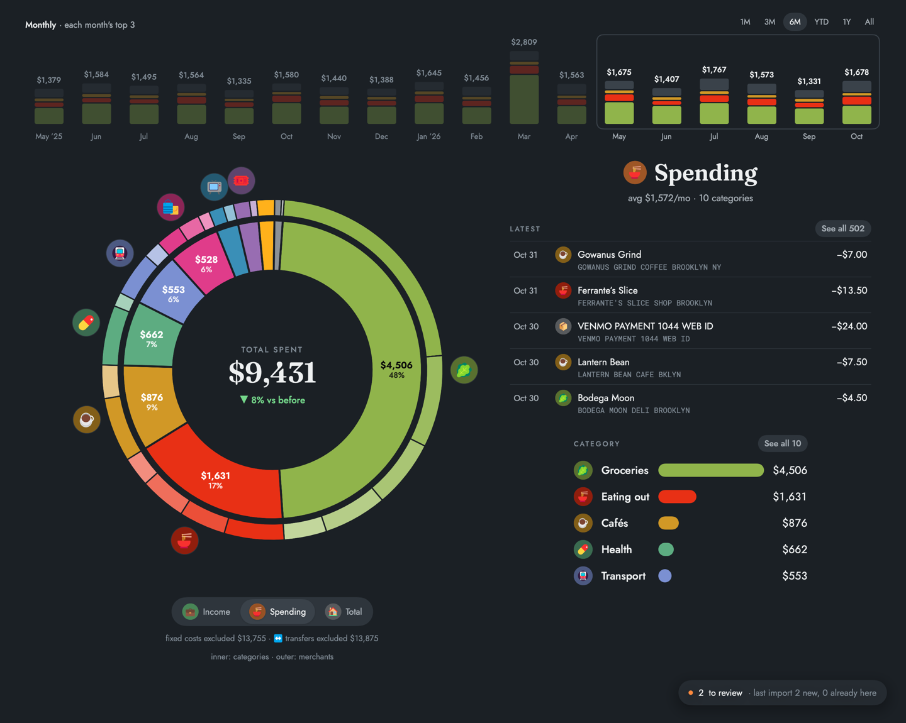

# Overview

Bookkeeper is a quiet ledger for a Mac. It keeps two things: what you hold in crypto, and where your money goes.

It draws the answers as rings you can touch. It has no account to make, takes no fee and sends no analytics. It is free, open source (GPL-3.0), and made by the House of Helios.

## Who it is for

You, if you want a clear picture of your money and would rather not hand the keys, or the bank login, to anyone.

- **Crypto.** You name a wallet and tell Bookkeeper what it holds. No wallet address is ever looked up and no key is ever asked for. Prices come from public sources.
- **Banking.** You export a CSV from your bank's website and drop it on the window. Bookkeeper reads it on your Mac and shows where the money went. Bank lines never leave the machine.
- **Stocks** has a door on the landing screen and a "Coming soon" under its name. That is all there is of it so far.

## What you need

A Mac with macOS 14 or newer. The next pages take you through [installing it](02-install.md) and [your first launch](03-first-run.md).
