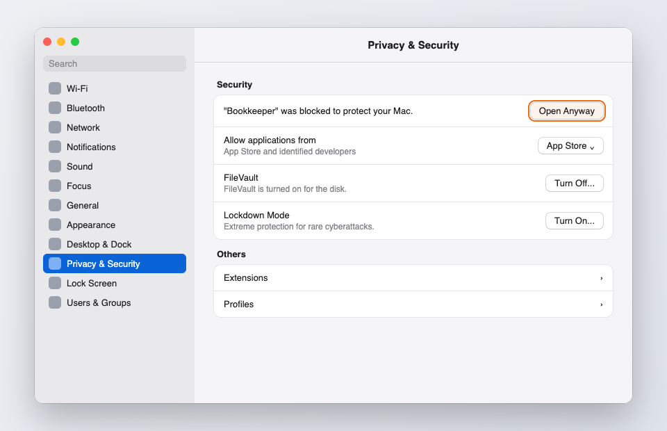

# Install

Bookkeeper needs macOS 14 or newer, on a Mac with Apple silicon (M1 or later). It does not run on Intel Macs.

1. Download `Bookkeeper.zip` from the [latest release](https://github.com/House-of-Helios/bookkeeper/releases/latest) on GitHub.
2. Double-click the zip to unpack it. You get `Bookkeeper.app`.
3. Drag `Bookkeeper.app` into your Applications folder.
4. Open it. The first time, macOS will hesitate. See below.

## Why macOS hesitates

Bookkeeper is signed ad hoc. The House of Helios does not pay for an Apple developer account, so Apple has not vouched for the app, and macOS says so on first open. Nothing is wrong with the file. The check is just a toll the House chose not to pay.

You only have to do this once.

**On macOS 15 and newer: System Settings**

1. Try to open the app once, and let macOS refuse. Click **Done**.
2. Open System Settings, then Privacy & Security.
3. Scroll down to the message about Bookkeeper and click **Open Anyway**, then confirm.

**On macOS 14: right-click**

1. In Applications, right-click `Bookkeeper.app`.
2. Choose **Open**.
3. In the dialog, click **Open** again.

The System Settings way works on macOS 14 too.

After that, it opens like any other app. Later versions arrive from inside the app; see [Updates](08-updates.md).
