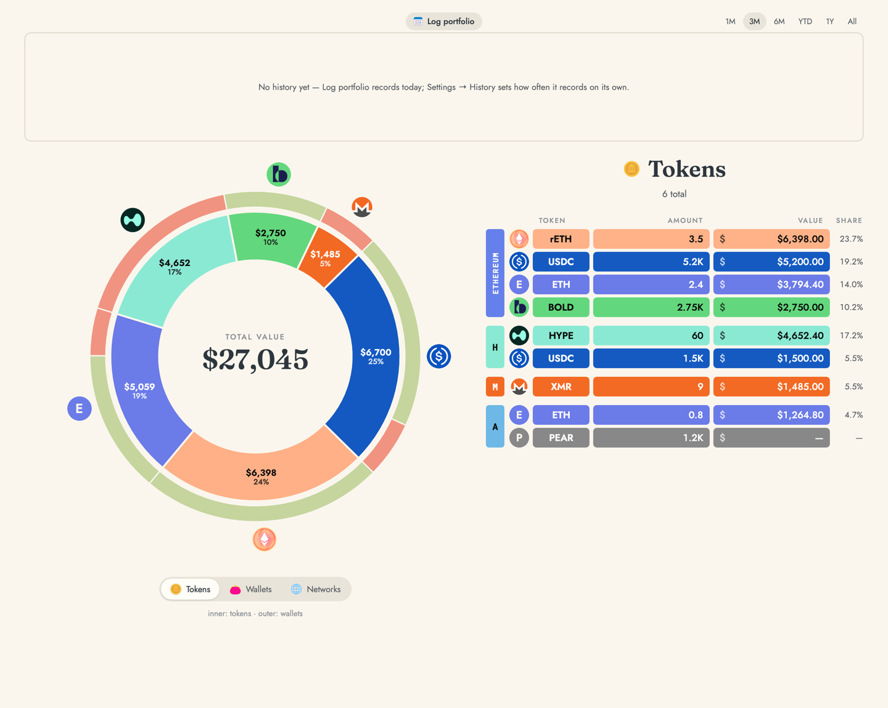

# First run

Here is what happens the first time you open Bookkeeper.

1. **A beat of the mark.** The window is see-through for a few seconds while a ring draws itself around the Bookkeeper mark. It is not loading anything; it is the old-fashioned way of saying hello.
2. **The landing.** The name, big, and three doors beneath it.

- **Banking** opens the spending side. See [Spending](05-spending.md).
- **Crypto** opens your holdings. See [Holdings](04-holdings.md).
- **Stocks** is dimmed and says "Coming soon". It does not open.

## Tor starts in the background

Prices and logos are fetched through Tor, which is bundled inside the app. On a first start Tor has to download its directory, which usually takes a few seconds and can take a minute. Bookkeeper waits for it before asking for anything. While it connects, Settings shows "Connecting to Tor · a first start can take a minute". When it is ready, it shows "Connected through Tor".

Nothing is fetched until Tor is up. See [Privacy](06-privacy.md).

## Where your data lives

Everything is stored on your Mac, in:

`~/Library/Application Support/Bookkeeper/`

These are plain files you can read and back up. The crypto side keeps `wallets.txt`, `history.csv` and `quotes.json` there; spending lives in a `spending` folder beside them. Nothing is stored anywhere else.

A fresh install is empty. Crypto starts with no wallets and Banking waits for its first file.
