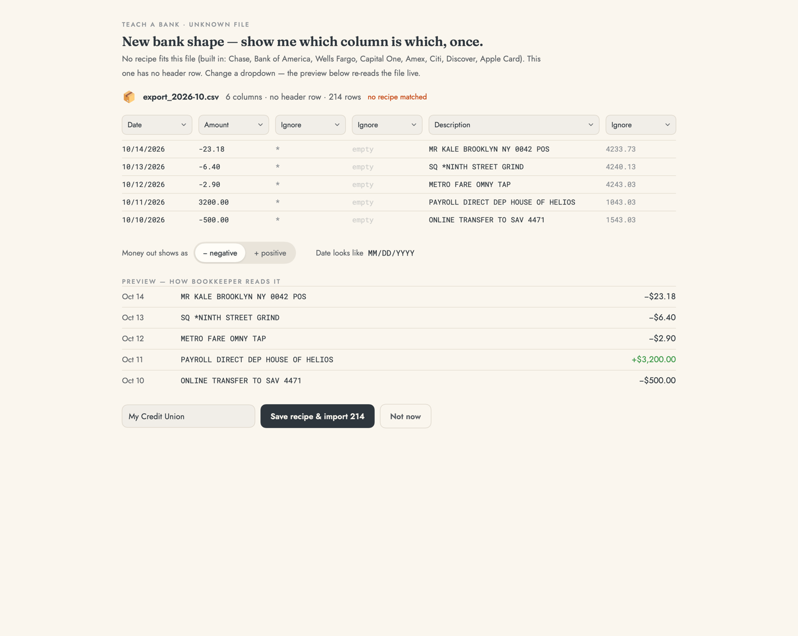

# First run

## The landing

Bookkeeper opens with a short intro: the window is see-through for a few seconds while a ring draws itself around the Bookkeeper mark. Nothing loads during it. Then the landing appears: the name, and three doors.

- **Banking** opens your bank data. See [Banking](04-banking.md).
- **Crypto** opens your holdings. See [Crypto](05-crypto.md).
- **Stocks** is dimmed and says "Coming soon". It does not open. See [Stocks](06-stocks.md).

A fresh install is empty.

## 1. Start with a bank file

1. On your bank's website, export your transactions as a CSV.
2. Open **Banking**. It says "Drop a bank CSV here".
3. Drop the file anywhere on the window. Or choose File, then **Import CSV…**, or press Shift-Command-I.

If Bookkeeper knows your bank, the rings appear. If not, it asks you once which column is which.

The full walk-through is in [Banking](04-banking.md).

## 2. Or start with crypto

Open **Crypto**, add a wallet by name, then enter what it holds. See [Crypto](05-crypto.md).

## Tor starts in the background

Prices and logos for Crypto are fetched through Tor, which is bundled inside the app. On a first start Tor has to download its directory, which usually takes a few seconds and can take a minute. Bookkeeper waits for it before asking for anything. While it connects, Settings shows "Connecting to Tor · a first start can take a minute". When it is ready, it shows "Connected through Tor".

Banking never goes online, so it does not wait for Tor. See [Privacy](07-privacy.md).

## Where your data lives

Everything is stored on your Mac, in:

`~/Library/Application Support/Bookkeeper/`

These are plain files you can read and back up. Crypto keeps `wallets.txt`, `history.csv` and `quotes.json` there. Banking lives in a `spending` folder beside them. Nothing is stored anywhere else.
