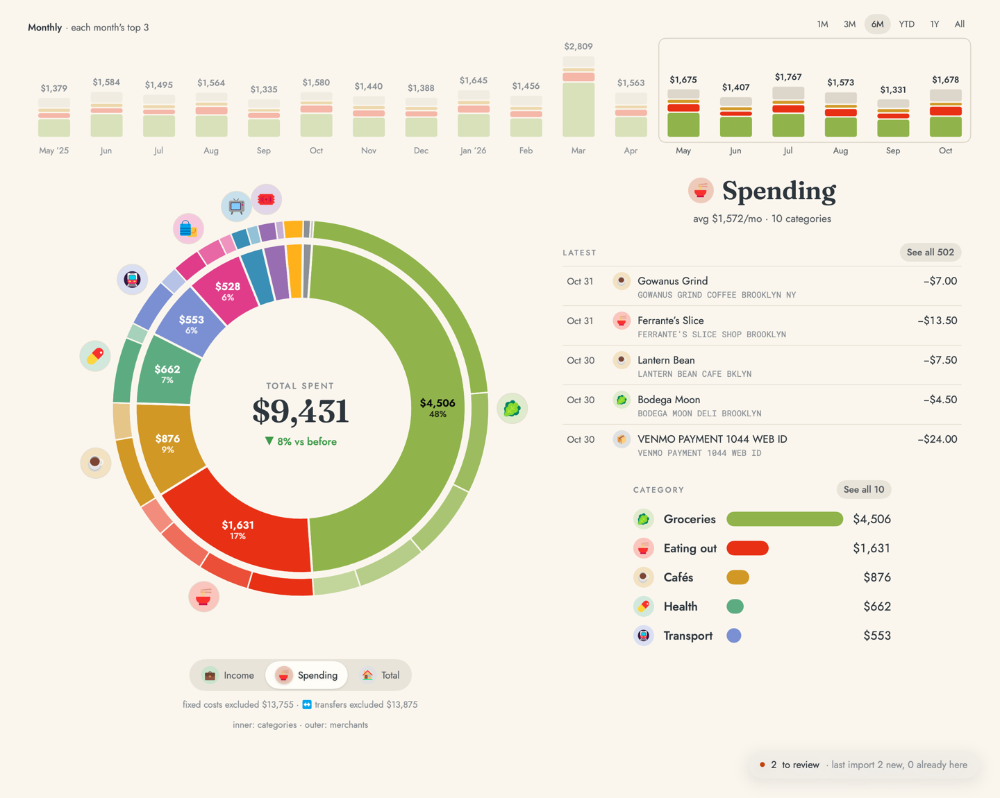
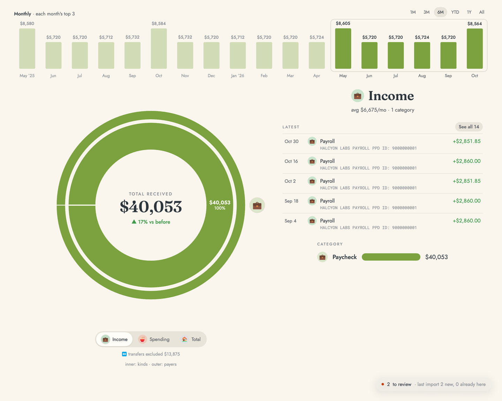
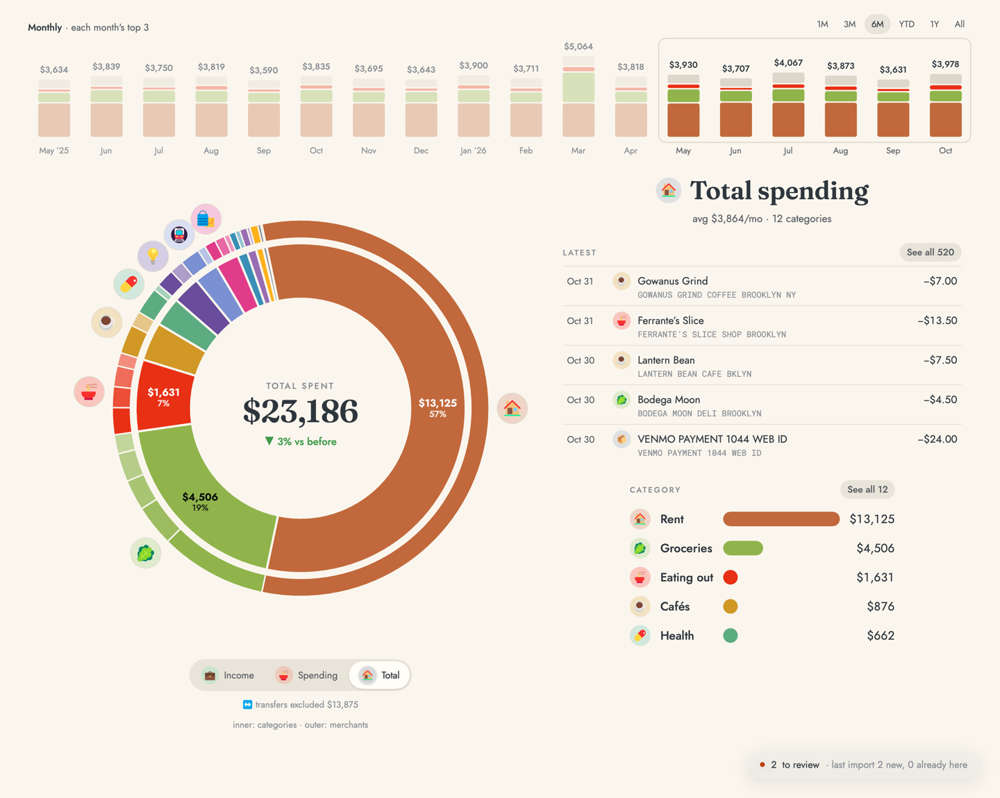
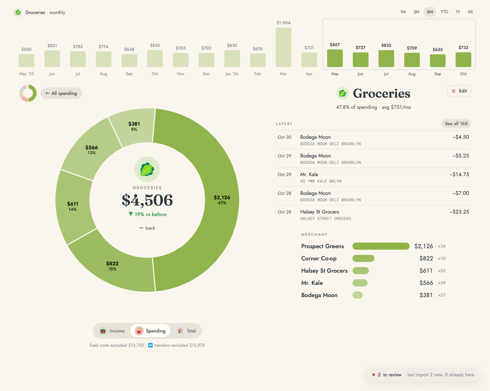
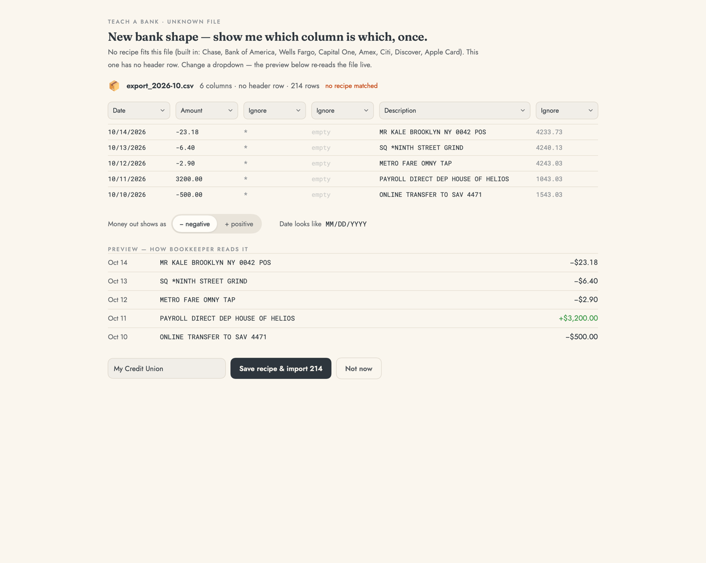

# Banking

Open **Banking** on the landing screen. It shows where your money came from and where it went, drawn from the bank files you give it.

**Bookkeeper never connects to a bank and never asks for a bank login.** You download a CSV export from your bank's website yourself and drop it in. Bookkeeper reads that file on your Mac. It does not go online for Banking at all.

## Bring in a file

1. On your bank's website, export your transactions as a CSV.
2. Drop the file anywhere on the Bookkeeper window. Or choose File, then **Import CSV…**, or press Shift-Command-I.

Banking starts empty, with the invitation "Drop a bank CSV here". Settings, in Banking, also has an **Import CSV…** button.

## Three lenses: Income, Spending, Total

A switch under the ring picks what the ring counts. Every lens uses the same month bars across the top, the 1M to All range buttons, and the same layout.

### Spending

The default. Everyday spending: money out, **without** your fixed costs. The line under the switch says what was set aside ("fixed costs excluded"). Fixed costs are the categories Rent, Utilities, Taxes, Insurance and Loans. You can mark your own categories as fixed too. Inner ring: categories. Outer ring: merchants.

### Income

Money in. Inner ring: kinds of income. Outer ring: who paid you. The centre reads "Total received".

### Total

All spending, with the fixed costs put back. Rent, utilities and the rest are in the ring, and the panel is headed "Total spending". The centre reads "Total spent".

Under the switch, every lens shows "transfers excluded" with the amount. See [Transfers](#transfers-and-card-payments-stay-out) below.

## Open a category

Click a slice, or a category in the list. The ring zooms into that category: its months as bars, its merchants as slices, its latest lines with the bank's own text under each name.

## Banks it already knows

These need no teaching:

- Chase (card and checking)
- Bank of America (checking)
- Wells Fargo
- Capital One
- American Express
- Citi
- Discover
- Apple Card

## A bank it does not know

Drop a file from another bank and a screen headed "New bank shape — show me which column is which, once." appears.

1. Above each column, pick what it is: Date, Description, Amount, or Ignore. If money out and money in have their own columns, pick those instead.
2. Say how money out shows up: negative or positive.
3. Check the format shown beside "Date looks like".
4. Read the preview underneath. It re-reads the file live as you change things.
5. Name the bank, then click **Save recipe & import**. Or click **Not now** to leave the file alone.

Next time a file of that shape arrives, Bookkeeper knows it.

## Overlapping exports

Exports tend to overlap: last month's file and this month's share a few days. Drop them both. Lines Bookkeeper has already seen are not counted twice. After each import it tells you what happened, such as "212 new · 40 already here · 3 to review".

Lines that look nearly the same, or look like transfers, wait in a **To review** queue until you answer them.

## Transfers and card payments stay out

Paying your credit card from your checking account is not spending; the spending was on the card. A move to savings is not spending either. Bookkeeper marks these "Internal transfer": "Money moving between your own accounts — a card payment, a move to savings. Never counted as spending or income." Their total shows under the ring as "transfers excluded".

If it gets one wrong, open the line and change what it **Counts as**.

## Rename a merchant once

Bank lines are shouted in capitals and padded with numbers. Open a line and give it a **Name**. You can also change its category. Then choose how far the change goes:

- **Just this one**, or
- all the lines like it, which also covers future imports.

The original text from the bank stays visible in the line's detail ("from the bank: …").

## Start over

Settings, in Banking, has **Start over…**. It deletes every bank file, entry, name and rule on this Mac. Crypto is not touched. It cannot be undone.
