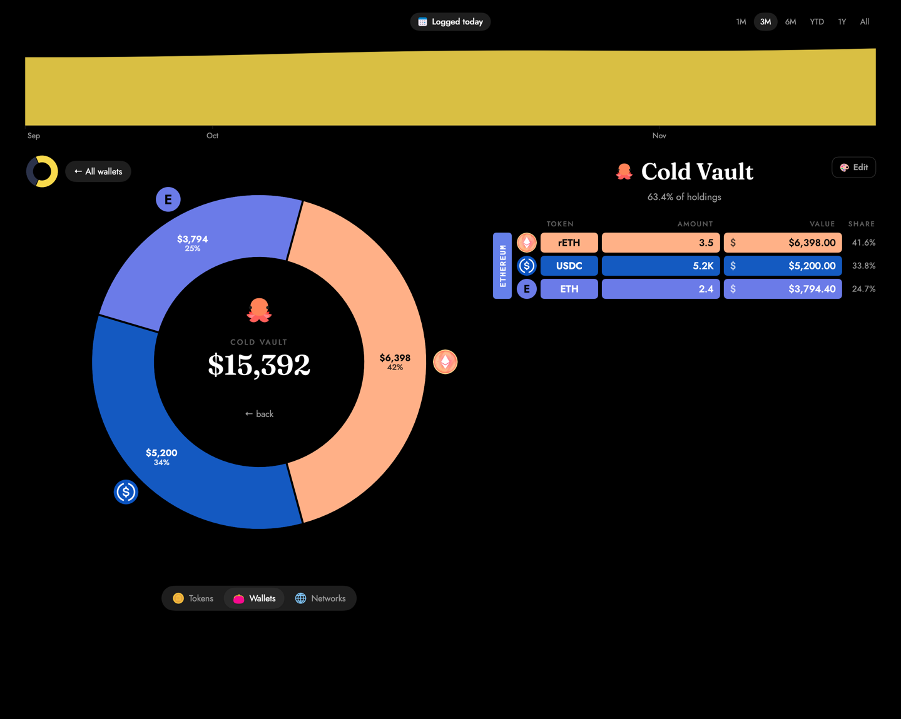
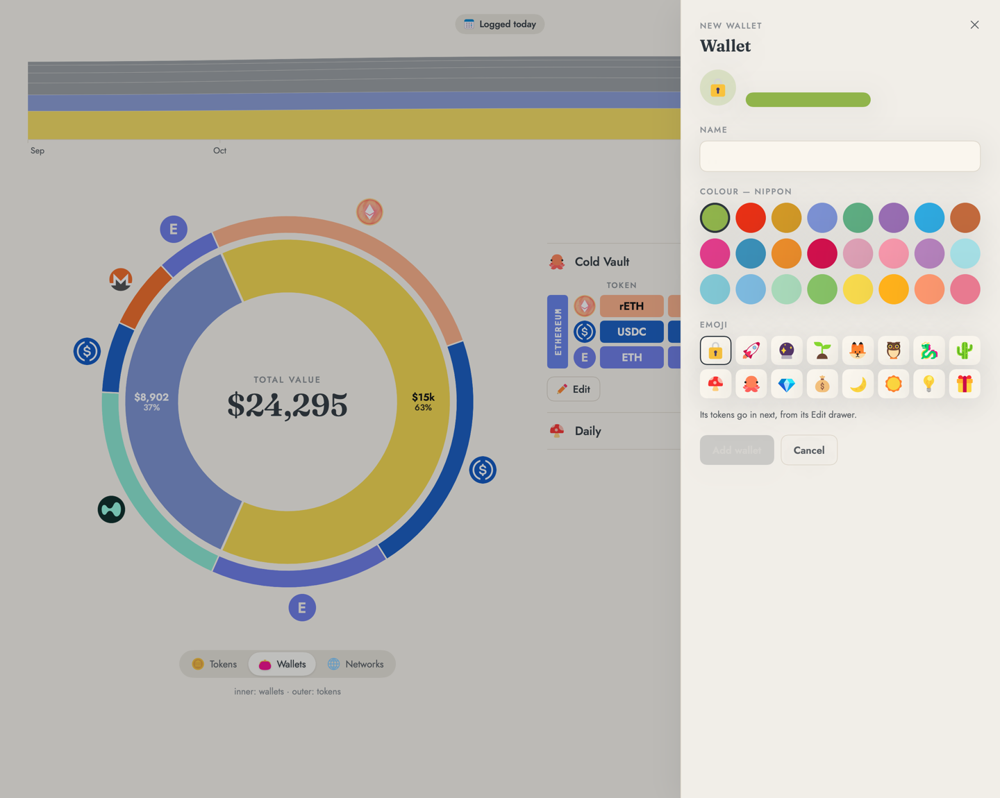
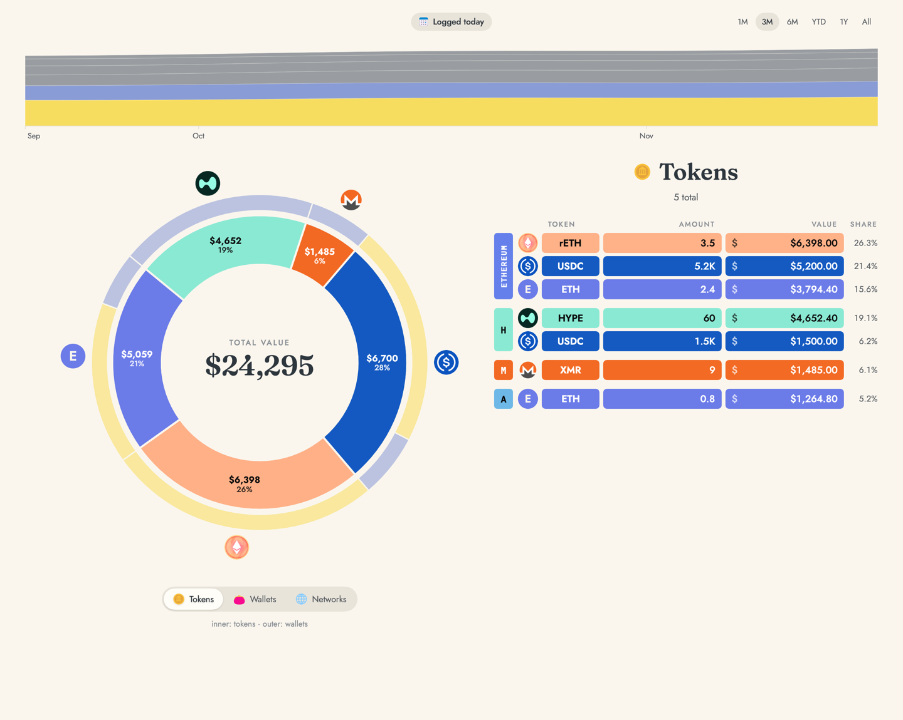

# Crypto

Open **Crypto** on the landing screen. Bookkeeper keeps a list of what you say you hold, prices it, and draws it as rings.

## No address, no keys

You never paste a wallet address, and Bookkeeper never looks one up. It does not read the chain. You tell it the amounts yourself and it does the arithmetic. The price of this is typing a number; the gain is that no one can learn from Bookkeeper what you own.

## Add a wallet

A wallet here is just a name and a place to put tokens.

1. Add a new wallet. A drawer slides in headed "New wallet".
2. Type a **Name** (the field suggests "Cold storage, Daily, Savings"). Two wallets cannot share a name.
3. Pick a colour and an emoji.
4. Click **Add wallet**.

## Put tokens in it

The drawer says it plainly: "Its tokens go in next, from its Edit drawer."

1. Open the wallet and click **Edit**.
2. In the "Contract address or coin name" box, type a coin's name or a token's contract address.
3. Type the **Amount**.
4. Click **Add**.

If the coin lives on more than one network, Bookkeeper asks which. To change an amount later, open **Edit** again and change the number. You can also take a token out there, rename the wallet, or remove it. Removing a wallet deletes the wallet and the tokens entered in it; its past days stay in the history.

If the sites cannot be reached at that moment, the box says so ("Couldn't reach the price sites just now") rather than telling you the coin does not exist.

## Prices and logos

- Prices and 24-hour changes come from DefiLlama. No key is needed.
- Logos come from public icon registries.
- Prices refresh every 5 minutes while the app is open.
- Everything is fetched through Tor. See [Privacy](07-privacy.md).

## A free CoinGecko key, if you want it

A few long-tail tokens have no market on DefiLlama. For those, you can add a free CoinGecko demo key.

1. Get a demo key at coingecko.com, under Developers, then Dashboard.
2. Open Settings in Crypto and find **API KEY (optional)**.
3. Paste the key into "CoinGecko demo key" and click **Save**.

Without a key, everything else works the same. Only those few tokens may go unpriced.

## History

**Log portfolio** at the top of the screen records today's value. Under Settings, History, you can choose "monthly", "twice a month" or "by hand". The chart across the top is drawn from these records.
