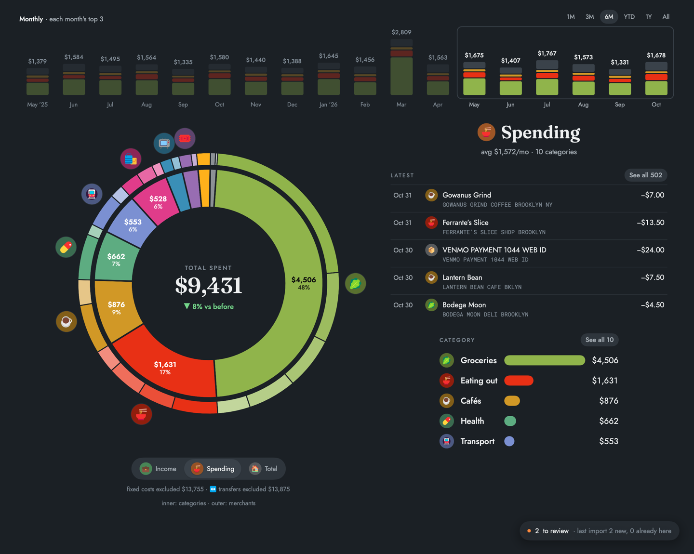
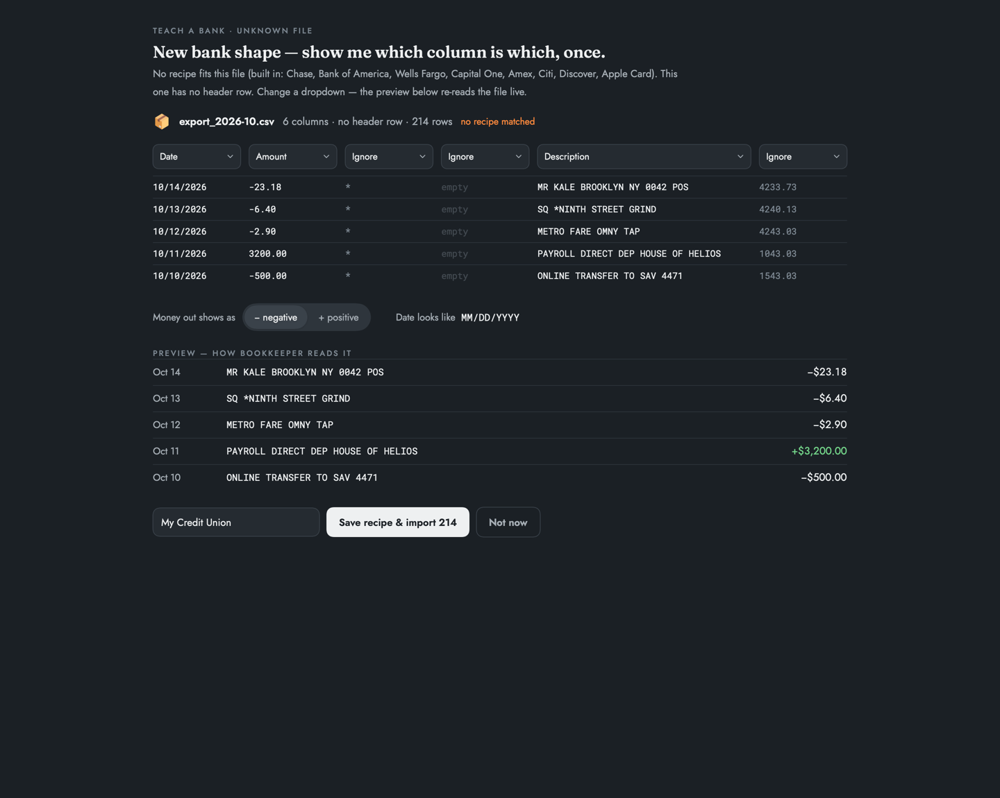

# Spending (Banking)

Open **Banking** on the landing screen. It starts empty, with an invitation: "Drop a bank CSV here".

## Bring in a file

1. On your bank's website, export your transactions as a CSV.
2. Drop the file anywhere on the Bookkeeper window. Or choose File, then **Import CSV…**, or press Shift-Command-I.

Bookkeeper reads the file on your Mac. It does not go online, and there is no bank login to hand over.

## Banks it already knows

These need no teaching:

- Chase (card and checking)
- Bank of America (checking)
- Wells Fargo
- Capital One
- American Express
- Citi
- Discover
- Apple Card

## A bank it does not know

Drop a file from some other bank and a screen headed "New bank shape — show me which column is which, once." appears.

1. Above each column, pick what it is: Date, Description, Amount, or Ignore. If money out and money in have their own columns, pick those instead.
2. Say how money out shows up: negative or positive.
3. Check the format shown beside "Date looks like".
4. Read the preview underneath. It re-reads the file live as you change things.
5. Name the bank, then click **Save recipe & import**. Or click **Not now** to leave the file alone.

Next time a file of that shape arrives, Bookkeeper knows it.

## Overlapping exports

Exports from your bank tend to overlap: last month's file and this month's share a few days. Drop them both. Lines Bookkeeper has already seen are not counted twice. After each import it tells you what happened, such as "212 new · 40 already here · 3 to review".

Lines that look nearly the same, or look like transfers, wait in a **To review** queue until you answer them.

## Transfers and card payments stay out

Paying your credit card from your checking account is not spending; the spending was the card's. A move to savings is not spending either. Bookkeeper marks these as "Internal transfer", described in the app as "Money moving between your own accounts — a card payment, a move to savings. Never counted as spending or income." They show under the rings as "transfers excluded", with the total.

If it gets one wrong, open the line and change what it **Counts as**.

## Rename a merchant once

Bank lines are shouted in capitals and padded with numbers. Open a line and give it a **Name**. You can also change its category. Then choose how far the change goes:

- **Just this one**, or
- all the lines like it, which also covers future imports.

The original text from the bank stays visible in the line's detail ("from the bank: …").

## Start over

Settings, in Banking, has **Start over…**. It deletes every bank file, entry, name and rule on this Mac. Crypto is not touched. It cannot be undone.
