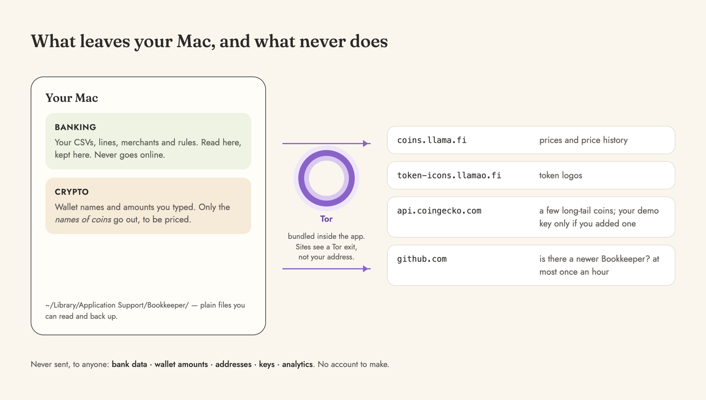

# Privacy

Bookkeeper has no account, no analytics, no ads and no AI. This page lists everything that leaves your Mac, and says what does not.

## What leaves the Mac

Every lookup goes through Tor, which is bundled inside the app ([Arti](https://gitlab.torproject.org/tpo/core/arti), the Tor Project's Rust client). The sites below see a Tor exit, not your IP address.

| Host | What for | What it learns |
|---|---|---|
| `coins.llama.fi` | Prices and price history | The coins being priced. Not which wallet, nor how much. |
| `token-icons.llamao.fi`, `icons.llamao.fi` | Token logos | The tokens whose logos are fetched. |
| `api.coingecko.com` | A few long-tail prices and logos. Your demo key is sent here only if you added one. | The few coins DefiLlama does not cover. |
| `github.com` | The update feed, and the download when you install an update | That someone checked for or fetched a release. |

Prices refresh every 5 minutes while the app is open. Update checks are covered in [Updates](07-updates.md).

## What never leaves

- **Bank data.** Your CSVs, lines, names and rules stay on the Mac. Banking never goes online, and the app says so in Settings.
- **Your wallets and amounts.** You type them in yourself; no address is looked up and nothing is sent.
- **Keys.** Bookkeeper never asks for a wallet key.

## No fallback to direct

If Tor cannot connect, nothing is fetched. Bookkeeper waits with the last prices it has. It does not quietly go direct.

There is one switch, and it is yours. Settings in Crypto has a **TOR** section with "through Tor" and "direct" for prices and logos. It is on "through Tor" from the start. Choosing "direct" sends lookups straight from your connection, and the app then says that DefiLlama and CoinGecko can see your IP address.

## Where things are kept

Everything lives in `~/Library/Application Support/Bookkeeper/`, as plain files you can read and back up. See [First run](03-first-run.md).
