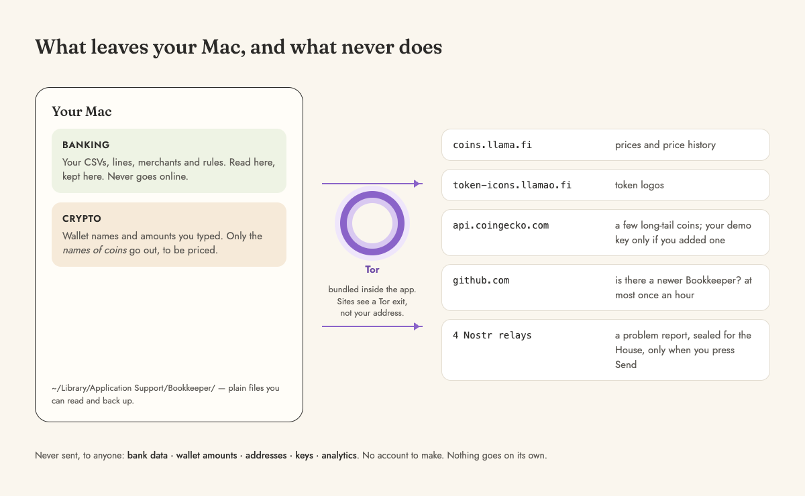

# Privacy

Bookkeeper has no account, no analytics, no ads and no AI. It never connects to your bank. This page lists everything that leaves your Mac, and says what does not.

## What leaves the Mac

Every lookup goes through Tor, which is bundled inside the app ([Arti](https://gitlab.torproject.org/tpo/core/arti), the Tor Project's Rust client). The sites below see a Tor exit, not your IP address.

| Host | What for | What it learns |
|---|---|---|
| `coins.llama.fi` | Prices and price history | The coins being priced. Not which wallet, nor how much. |
| `token-icons.llamao.fi`, `icons.llamao.fi` | Token logos | The tokens whose logos are fetched. |
| `api.coingecko.com` | A few long-tail prices and logos. Your demo key is sent here only if you added one. | The few coins DefiLlama does not cover. |
| `github.com` | The update feed, and the download when you install an update | That someone checked for or fetched a release. |
| `nos.lol`, `relay.primal.net`, `relay.snort.social`, `nostr.mom` | A problem report, only when you press **Send** (from version 2.0.23; see below) | Nothing readable: the report is sealed so only the House can open it, from a one-time sender. |

Prices refresh every 5 minutes while the app is open. Update checks are covered in [Updates](08-updates.md).

## What stays on the Mac

- **Bank data.** Your CSVs, lines, names and rules stay on the Mac. Banking never goes online, and the app says so in Settings. Bookkeeper has no bank login to leak, because it never asks for one.
- **Your wallets and amounts.** You type them in yourself; no address is looked up and nothing is sent.
- **Keys.** Bookkeeper never asks for a wallet key.

## Problem reports

Bookkeeper keeps no automatic error log that leaves the Mac. Nothing about a crash or a problem is sent unless you send it.

- **When.** Settings has **Send feedback…**. If Bookkeeper closed unexpectedly, it offers the same sheet the next time it opens. Close the sheet and nothing happens.
- **What it holds.** The Bookkeeper version, the macOS version, the kind of Mac (Apple silicon or Intel), the look and whether Tor is on, how many wallets and banks you have (counts only), the last 40 lines of Bookkeeper's own log, and what you write. Before you see it, Bookkeeper takes out home folder names, wallet addresses, amounts, IP addresses, e-mail addresses and the names of your own machines. Bank lines are never put in at all. [Problem reports](09-feedback.md) shows a worked example, before and after.
- **You see all of it.** The whole report is shown before anything happens, and you can edit or delete any of it.
- **Where it goes.** **Copy** and **Save…** keep it with you, to pass on however you like. **Send** (from version 2.0.23) seals the report so only Bookkeeper's makers can read it, with a key that belongs to Bookkeeper alone, signs it with a key made for that one report, and hands it through Tor to the four public Nostr relays above. The relays hold sealed text for 30 days. No account, no e-mail, no server of the House's own, and your IP address is never seen.

## No fallback to direct

If Tor cannot connect, nothing is fetched. Bookkeeper waits with the last prices it has. It does not quietly go direct.

There is one switch, and it is yours. Settings in Crypto has a **TOR** section with "through Tor" and "direct" for prices and logos. It is on "through Tor" from the start. Choosing "direct" sends lookups straight from your connection, and the app then says that DefiLlama and CoinGecko can see your IP address.

## Where things are kept

Everything lives in `~/Library/Application Support/Bookkeeper/`, as plain files you can read and back up. See [First run](03-first-run.md).
