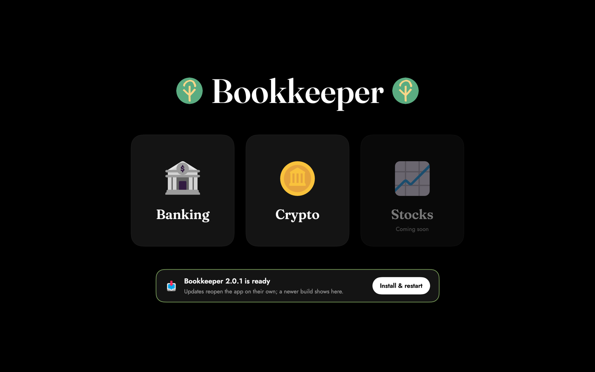

# Updates

Bookkeeper updates itself from the project's GitHub releases. Nothing else is involved, and there is no update server.

## How it checks

While the app is open it looks at the latest GitHub release, through Tor, at most once an hour. If Tor is not up yet or the network is down, it simply tries again on a later pass.

## How it trusts an update

An update from the internet is only as good as the checks on it. Each one passes two before anything is unpacked:

1. **SHA-256.** The download must match the fingerprint published with the release.
2. **Ed25519 signature.** The release is signed with the project's private key, kept off the internet. The matching public key is built into the app (see `BookkeeperCore/Sources/BookkeeperCore/ReleaseFeed.swift` in the source). A download that fails either check is thrown away, and the app says so.

## Installing

When a newer version is found, Bookkeeper fetches it quietly in the background. The landing screen then shows a card: "Bookkeeper X is ready" (X being the version), with the release notes.

1. Click **Install & restart**.
2. Bookkeeper swaps in the new version and reopens.

The pill at the top can also open a sheet with "What's new" for every version you have missed. It offers **Later** or **Install & restart**.

You can also ask by hand: Settings has a **Check for updates** button, with the current version beside it.
