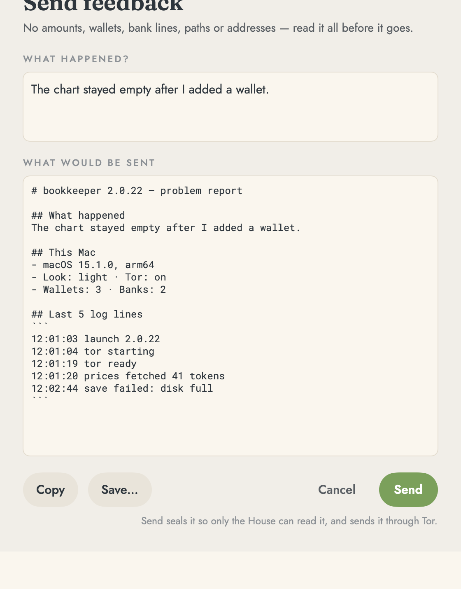

# Report a problem

Something wrong, or an idea? Bookkeeper can write the report for you, show you every word of it, and send it only if you say so.

## How to report a problem

1. Open Settings and choose **Send feedback…**. If Bookkeeper closed unexpectedly, it offers the same sheet the next time it opens.
2. Write what happened under **What happened?** The report below fills in as you type.
3. Read the report. Change or delete anything you like.
4. Press **Send**, or **Copy** or **Save…** to pass it on yourself. **Cancel** sends nothing.

## What a report holds

The Bookkeeper and macOS versions, the kind of Mac, the look, whether Tor is on, how many wallets and banks you have (counts only), the last 40 lines of Bookkeeper's own log, and your note.

Before you see it, Bookkeeper takes out home folder names, wallet addresses, amounts, IP addresses, e-mail addresses and the names of your own machines. Bank lines are never put in.

## Where it goes

**Send** seals the report with a key that belongs to Bookkeeper alone, so only its makers can open it. It signs the report with a key made for that one report, and hands it through Tor to four public Nostr relays: `nos.lol`, `relay.primal.net`, `relay.snort.social` and `nostr.mom`. The relays hold sealed text for 30 days.

There is no account, no e-mail and no server of the House's own, and your IP address is never seen. If Tor is not connected, or no relay takes it, the sheet says so and nothing is sent; **Copy** and **Save…** still work.

Send is in version 2.0.23 and later. See [Privacy](07-privacy.md) for everything else that leaves the Mac.
